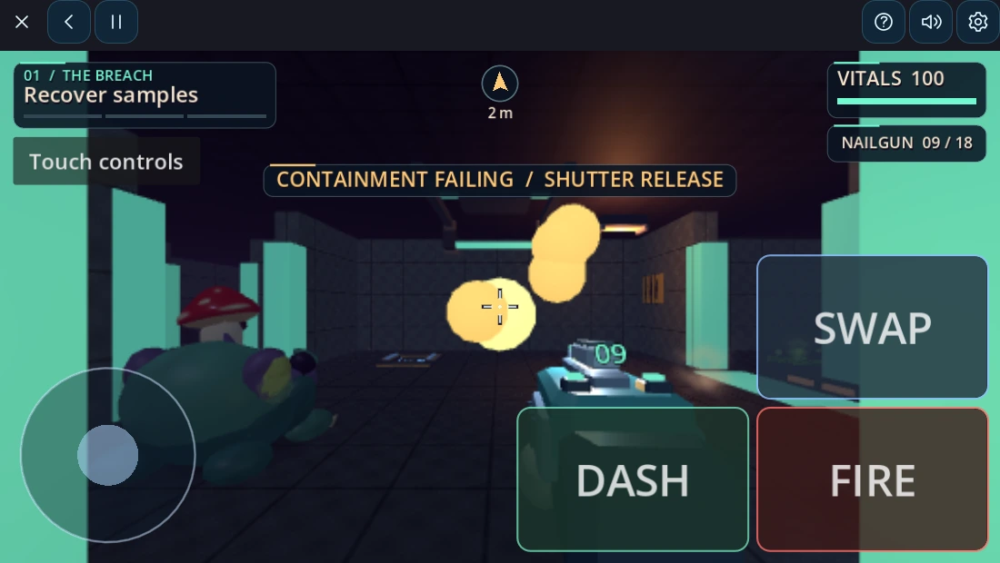
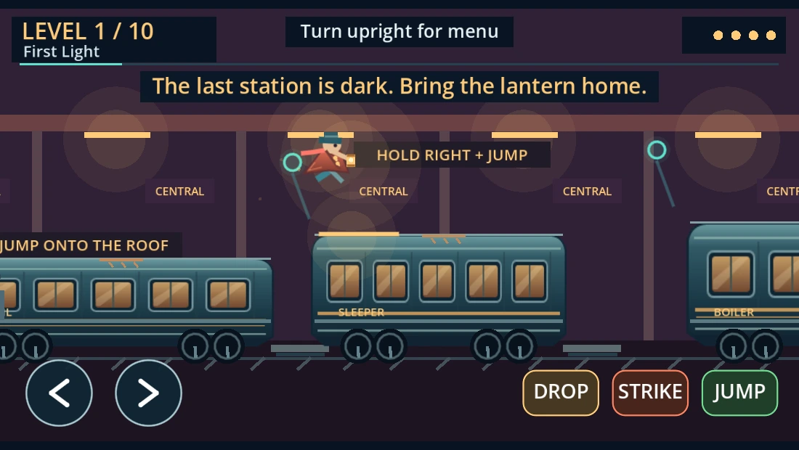
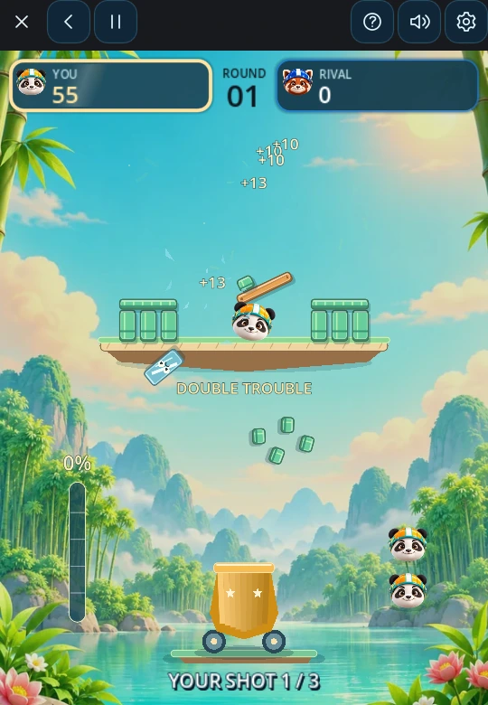
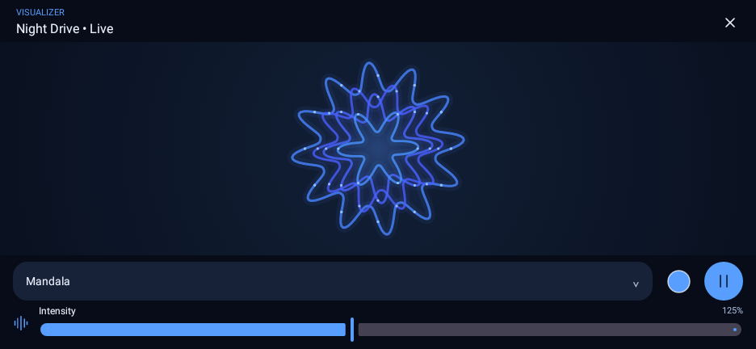
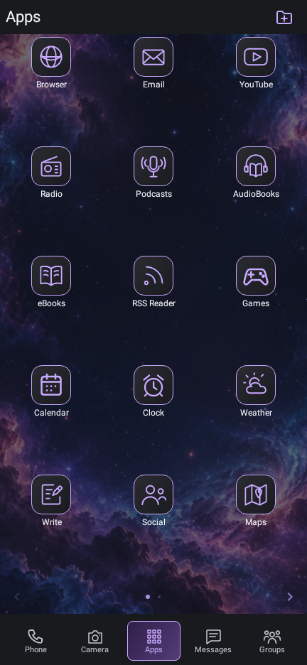

# OnKlav

**A Virtual Operating System and Game Console for Android**

*Pronounced “Enclave,” a protected, self-contained territory.*

OnKlav puts you in control of more of your Android experience. Set up a desktop
that works for you, install apps and games shared directly by their creators,
and get free access to built-in tools, games, and public-domain books. You can
do more on your phone with less reliance on Google Play.

**Messaging is at the heart of OnKlav.** Keep your closest friends and family
a tap away with built-in Messages and Groups. Share photos and everyday updates,
or turn a text exchange into a turn-based game with a friend.

Organize your everyday tools, listen to live radio streams from around the world
and transform them into hypnotic visualizations, or play a bundled game offline.
OnKlav runs inside Android and includes both App and Game SDKs.

**[Download OnKlav for Android · 133 MB APK](https://github.com/JustTrySomthing/OnKlav/releases/download/v0.101.49-rc1/OnKlav-0.101.49-RC.apk)** · [Release notes and SDK downloads](https://github.com/JustTrySomthing/OnKlav/releases/tag/v0.101.49-rc1)

Start with the essentials in one optimized, signed APK. Get **39 built-in apps
and tools** for messaging, browsing, files, listening, and editing, plus **8 games**.
They’re ready to open after installation.

This **0.101.49-rc1** prerelease supports ARM64 devices running Android 10 or newer.
Download the APK, open it on Android, and follow the installation prompt.

[See OnKlav in action](#see-onklav) · [Themes](#themes) · [Included games](#included-games) · [Included apps](#included-apps) · [Make, share, and install](#make-share-and-install)

## Keep your favorite people one tap away

| A family conversation | Open the magic wand |
| :---: | :---: |
|  |  |

*Illustrations use sample conversations.*

- **Go beyond a text.** Tap the magic wand in a one-on-one conversation to open
  Conversation Activities. Choose **Voice chat** for Walkie-Talkie or **Play game**
  to invite a friend to a supported turn-based game.
- **Find and save what matters.** Open the media **Gallery** to find shared photos,
  audio, video, and attachments. Star the messages you want to keep, then find
  them again in **Starred**, your conversation favorites tab.
- **Give messages a voice and a reaction.** Use built-in text-to-speech to listen
  to individual messages, and reply with animated emoji reactions.
- **Share with your circle.** [Real Social](docs/REAL-SOCIAL.md) lets you share
  posts, replies, and media directly with accepted friends over SMS and MMS.

On first launch, follow OnKlav’s setup checklist. To use Messages for SMS and MMS,
choose OnKlav as the default messaging app when Android asks and review the
requested permissions. Then open Messages or Groups and start a conversation.
Setup can be finished later from Settings.

## What to try first

- **Start with your favorite people.** Open Messages or Groups to text your
  friends and family. Pin the conversations you return to, share photos and
  files, and listen to individual messages with Read Aloud.
- **Set up your own space.** Put your favorite apps within reach and give the
  desktop a look you can save and share with [theme packages](docs/THEME-PACKAGES.md).
- **Find your next free read or listen.** Browse free ebooks from Project
  Gutenberg in eBooks, or find free audiobooks from LibriVox in AudioBooks.
- **Take a game with you.** Play a solo game offline, or invite a friend to an
  [SMS turn-based match](developer/games/SMS-TURNS.md) in supported titles.
  Both players need compatible OnKlav installs and cellular SMS service.

## See OnKlav

### Games in action

| Shroom | Last Light Express |
| :---: | :---: |
| <a href="artwork/github-gameplay/shroom.webp"></a> | <a href="artwork/github-gameplay/last-light-express.webp"></a> |
| Take on the outbreak one sector at a time. | Carry the last lantern across a moving train. |

| Crash Test Panda | Radio with Mandala |
| :---: | :---: |
| <a href="artwork/github-gameplay/crash-test-panda.webp"></a> | <a href="docs/evidence/radio-geometry-polish/visualizer-landscape-3.png"></a> |
| Launch a panda and bring down the tower. | Tune in and watch the patterns move with the music. |

*Gameplay captured from the shipped game exports in a browser. The Radio
and app interface screenshots are from development builds. Select an image to enlarge it.*

### The desktop and everyday tools

| OnKlav desktop | Files | Video Edit |
| :---: | :---: | :---: |
| <a href="docs/evidence/desktop-folders/main-navigation.png"></a> | <a href="docs/evidence/files-simplification/files-home.png"></a> | <a href="artwork/github-previews/video-edit-coast.webp"></a> |

*The Video Edit image pairs the app’s actual editor controls with an illustrated sample clip.*

## Themes

Choose a built-in look under **Settings → Appearance**. The same conversation
looks different in each preset, from the wallpaper and header accent to the
message bubbles and their text.

<a href="artwork/github-previews/message-themes.webp"></a>

*Illustrated previews using OnKlav’s built-in wallpapers and message colors.*
You can also save and share your own [theme packages](docs/THEME-PACKAGES.md).

## Included games

| Game | How to play |
| :---: | --- |
| <br>**Last&nbsp;Light&nbsp;Express** | **Solo.** Ten levels · fight across a moving train and face the Iron Warden. |
| <br>**Crash&nbsp;Test&nbsp;Panda** | **Solo.** Solo demolition: twelve courses, explosive chains and a shot-for-shot panda rivalry. |
| <br>**Shroom** | **Solo.** Fight through five spore-infested sectors and take down the Cap King. |
| <br>**Air&nbsp;Hockey** | **Solo.** Solo Air Hockey · ten goals · redesigned arcade table. |
| <br>**Naval&nbsp;Battle** | **Solo or SMS friend match.** Outsmart your opponent and destroy their ships. |
| <br>**Neon&nbsp;Dominos** | **Solo.** Earn pips by playing tiles, then subtract the pips you still hold. Highest total after three rounds wins. |
| <br>**Cats&nbsp;vs&nbsp;Dogs** | **Solo or SMS friend match.** Classic four in a row with a playful twist. |
| <br>**Blackjack** | **Solo or SMS friend match.** Test your luck and skill in a blackjack tournament. |

## Included apps

Find these built-in tools on the Apps desktop or bottom navigation.

<table>
  <tr><th colspan="3" align="left">Communication</th></tr>
  <tr>
    <td width="160" align="center"><br>Phone</td>
    <td width="160" align="center"><br>Messages</td>
    <td width="160" align="center"><br>Groups</td>
  </tr>
  <tr>
    <td width="160" align="center"><br>Email</td>
    <td width="160" align="center"><br>Real Social</td>
    <td width="160" align="center"><br>Walkie-Talkie</td>
  </tr>
  <tr><th colspan="3" align="left">Web &amp; listening</th></tr>
  <tr>
    <td width="160" align="center"><br>Browser</td>
    <td width="160" align="center"><br>YouTube</td>
    <td width="160" align="center"><br>RSS Reader</td>
  </tr>
  <tr>
    <td width="160" align="center"><br>Radio</td>
    <td width="160" align="center"><br>Podcasts</td>
    <td width="160" align="center"><br>AudioBooks</td>
  </tr>
  <tr>
    <td width="160" align="center"><br>eBooks</td>
    <td width="160" align="center"><br>Read Aloud</td>
    <td></td>
  </tr>
  <tr><th colspan="3" align="left">Create &amp; capture</th></tr>
  <tr>
    <td width="160" align="center"><br>Camera</td>
    <td width="160" align="center"><br>Image Edit</td>
    <td width="160" align="center"><br>Video Edit</td>
  </tr>
  <tr>
    <td width="160" align="center"><br>Audio Edit</td>
    <td width="160" align="center"><br>Voice Record</td>
    <td width="160" align="center"><br>Screen Record</td>
  </tr>
  <tr>
    <td width="160" align="center"><br>Write</td>
    <td width="160" align="center"><br>Code Edit</td>
    <td></td>
  </tr>
  <tr><th colspan="3" align="left">Files &amp; privacy</th></tr>
  <tr>
    <td width="160" align="center"><br>Files</td>
    <td width="160" align="center"><br>Cloud Files</td>
    <td width="160" align="center"><br>Docu View</td>
  </tr>
  <tr>
    <td width="160" align="center"><br>Compress</td>
    <td width="160" align="center"><br>Format Swap</td>
    <td width="160" align="center"><br>Vault</td>
  </tr>
  <tr>
    <td width="160" align="center"><br>Authentic</td>
    <td></td>
    <td></td>
  </tr>
  <tr><th colspan="3" align="left">Everyday tools</th></tr>
  <tr>
    <td width="160" align="center"><br>Calendar</td>
    <td width="160" align="center"><br>Clock</td>
    <td width="160" align="center"><br>Maps</td>
  </tr>
  <tr>
    <td width="160" align="center"><br>Weather</td>
    <td width="160" align="center"><br>Calc</td>
    <td width="160" align="center"><br>Convert</td>
  </tr>
  <tr>
    <td width="160" align="center"><br>Flashlight</td>
    <td width="160" align="center"><br>Power</td>
    <td></td>
  </tr>
  <tr><th colspan="3" align="left">System</th></tr>
  <tr>
    <td width="160" align="center"><br>Settings</td>
    <td width="160" align="center"><br>Games</td>
    <td></td>
  </tr>
</table>

## Built for everyday use

- **Keep your tools together.** Install signed `.onklav-a` apps and `.onklav-g`
  games inside OnKlav. It runs them in sandboxed environments and mediates
  access to supported device capabilities.
- **Stay in touch.** Use Messages and Groups for SMS and MMS. [Real Social](docs/REAL-SOCIAL.md)
  shares posts and replies with accepted friends over SMS, and uses MMS for media attachments.
  Carrier charges may apply.
## Make, share, and install

Build the app, utility, or game you want using the [App SDK](developer/README.md)
or [Game SDK](developer/games/README.md). Sign your package, then share the file
directly with friends or publish it wherever you like. Once OnKlav is installed,
its apps and games install **inside OnKlav without separate APKs or a Google Play
Store listing**.

1. **Get the package.** Use a signed file you made, downloaded, or received from someone else.
2. **Open OnKlav’s installer.** For an app (`.onklav-a`), go to **Settings → Apps → Install App**.
   For a game (`.onklav-g`), open **Games → Games manager → Install a game**.
3. **Select and install.** Review the publisher and any app permissions.
   Your new app appears in Apps, and your new game appears in Games.

## How it fits together

One APK contains the Kotlin/Compose host, shared Rust services, signed
internal apps, and the shared Godot Web game engine. The repository contains
the source for OnKlav 0.101.49-rc1 and both SDKs.

Start with [START-HERE.md](START-HERE.md), [current tasks](TODO.md), or the
[SDK guide](sdk/README.md).

## Speech

OnKlav includes two English text-to-speech choices for Messages, readers, and
SDK apps. Choose **Male (Bruno)**, the default, or **Female (Maya)**. Maya is an
OnKlav nickname for the existing Female option. The two bundled Kitten Nano
voices are classified as male upstream. See [shared speech](docs/NEURAL-SPEECH.md).

## Build

JDK17, SDK36/build-tools35, Gradle8.11.1 and the original Android signer are required. Reuse source-current native/SDK/game outputs. Changes to native speech need Rust1.90 and NDK27.2.12479018.

```sh
python3 scripts/build.py --plan
python3 scripts/build.py  # optimized release; debug is for development
python3 scripts/check_android.py --tests-only --test app.onklav.home.NeuralSpeechTest
```

Phone/carrier/Bluetooth/endurance and public distribution qualification remain separate from host tests and APK verification. Active backup/document adoption and Notes recovery protect existing user data. Historical milestones are retained in docs/history/pre-0.100.24. Keep third-party licenses/corresponding source and signing identities.

See [size and responsiveness](docs/SIZE-AND-RESPONSIVENESS.md) for measured package changes, preserved features and device-validation limits.

## Help improve OnKlav

Try the prerelease and [report a bug](https://github.com/JustTrySomthing/OnKlav/issues/new/choose),
improve a guide or share a theme, or contribute code. The
[contributor guide](CONTRIBUTING.md) explains setup, tests, and pull requests.
Browse [good first issues](https://github.com/JustTrySomthing/OnKlav/labels/good%20first%20issue)
if you’d like a small place to start.

## License

Copyright (C) 2026 OnKlav. OnKlav-owned host, App SDK, and Game SDK
code is licensed under GPL-3.0-or-later. See [LICENSE](LICENSE),
[App SDK licensing](developer/LICENSE.md), and
[Game SDK licensing](developer/games/LICENSE.md). Third-party
materials retain their own notices and terms. See the
[distribution review](docs/PUBLIC-RELEASE-LICENSING.md) for bundled
content and outstanding rights checks.
