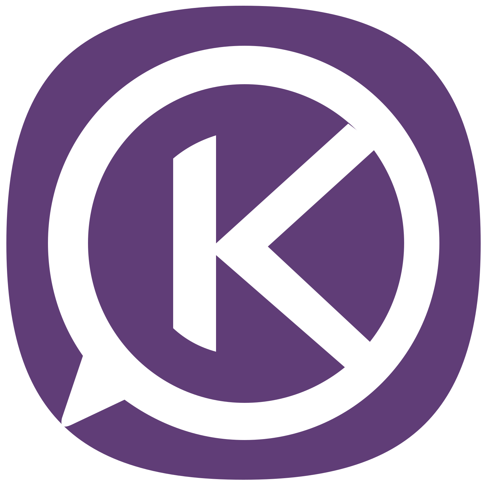

# OnKlav

**A Virtual Operating System and Game Console for Android**

*Pronounced “Enclave,” a protected, self-contained territory.*

**[Download OnKlav for Android · 133 MB APK](https://github.com/JustTrySomthing/OnKlav/releases/download/v0.101.54-rc1/OnKlav-0.101.54-RC.apk)** · [Release notes](https://github.com/JustTrySomthing/OnKlav/releases/tag/v0.101.54-rc1) · [SDK downloads](https://github.com/JustTrySomthing/OnKlav/releases/tag/v0.101.49-rc1)

**Updates built in.** Open **Settings → Check for updates** to download and install future versions. Optional automatic checks run once a day when you open OnKlav.

**Android 10+ · ARM64 · Prerelease 0.101.49-rc1 · 39 built-in apps and tools · 8 games**

OnKlav puts you in control of more of your Android experience. Customize your
desktop, share and install apps and games directly, and discover free tools,
games, ebooks, and audiobooks with less reliance on Google Play.

**Messaging is at the heart of OnKlav.** Keep your closest friends and family
a tap away with built-in Messages and Groups. Share photos and everyday updates,
or invite a friend to a turn-based game.

Listen to live radio streams from around the world and transform them into
hypnotic visualizations, or play a bundled game offline. Everything runs inside
Android from one optimized, signed APK.

[Install and set up](#install-and-set-up) · [See OnKlav in action](#see-onklav) · [Themes](#themes) · [Games](#included-games) · [Apps](#all-the-apps-you-need) · [Contribute](#help-improve-onklav)

<a href="#see-onklav">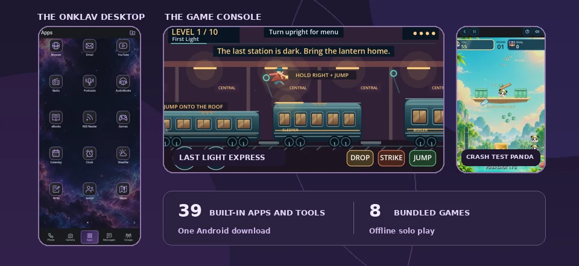</a>

## Stay in Touch and Spend more time with the People that matter most

| A family conversation | Open the magic wand |
| :---: | :---: |
| 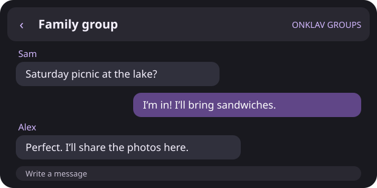 | 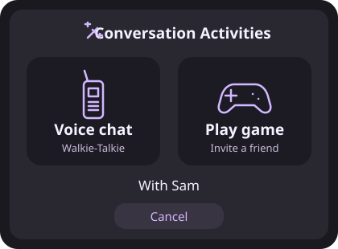 |

*Illustrations use sample conversations.*

- **Go beyond a text.** Tap the magic wand in a one-on-one conversation to open
  Conversation Activities. Choose **Voice chat** for Walkie-Talkie or **Play game**
  to invite a friend to a supported turn-based game.
- **Find and save what matters.** Open the media **Gallery** to find shared photos,
  audio, video, and attachments. Star the messages you want to keep, then find
  them again in **Starred**, your conversation favorites tab.
- **Give messages a voice and a reaction.** Use built-in text-to-speech to listen
  to individual messages, and reply with animated emoji reactions.

### Replace Toxic Social Media with Real Social

Share posts, replies, and media directly with accepted friends over SMS and MMS. No Big Tech, Fake Friends, Spam, Ads or Weirdos.

<table>
  <tr>
    <th align="center">Photo feed</th>
    <th align="center">Friends</th>
  </tr>
  <tr>
    <td align="center" valign="top"><a href="artwork/github-previews/real-social-feed.webp">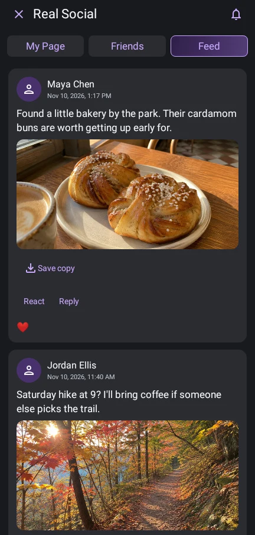</a></td>
    <td align="center" valign="top"><a href="artwork/github-previews/real-social-friends.webp">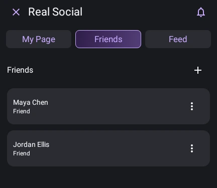</a></td>
  </tr>
</table>

[Explore Real Social](docs/REAL-SOCIAL.md)

## Install and set up

1. Download the signed APK, open it on your Android device, and follow the installation prompt.
2. Open OnKlav and follow its setup checklist. For SMS and MMS, choose OnKlav as the
   default messaging app when Android asks and review the requested permissions.
3. Open **Messages** or **Groups** to start a conversation, or explore **Apps** and
   **Games**. You can finish setup later from Settings.

## What to try first

- **Set up your own space.** Put your favorite apps within reach and give the
  desktop a look you can save and share with [theme packages](docs/THEME-PACKAGES.md).
- **Find your next free read or listen.** Browse free ebooks from Project
  Gutenberg in eBooks, or find free audiobooks from LibriVox in AudioBooks.
- **Take a game with you.** Play a solo game offline, or invite a friend to an
  [SMS turn-based match](developer/games/SMS-TURNS.md) in supported titles.
  Both players need compatible OnKlav installs and cellular SMS service.

## See OnKlav

### App previews

| Files | Video Edit |
| :---: | :---: |
| <a href="docs/evidence/files-simplification/files-home.png">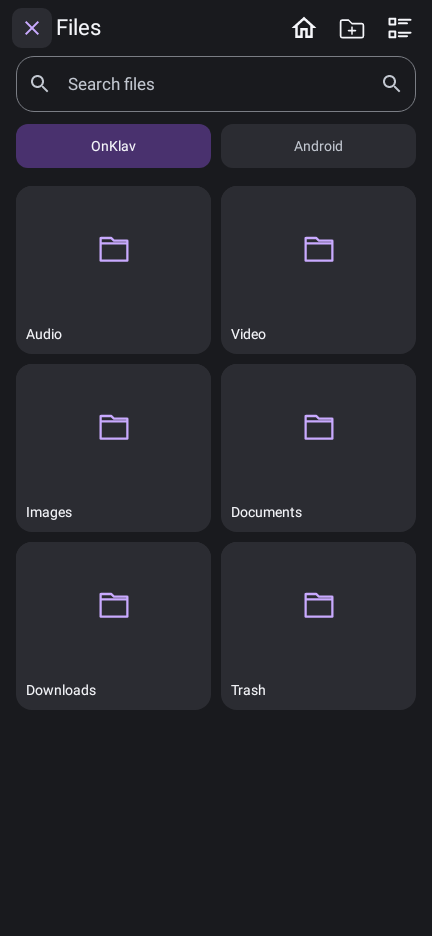</a> | <a href="artwork/github-previews/video-edit-coast.webp">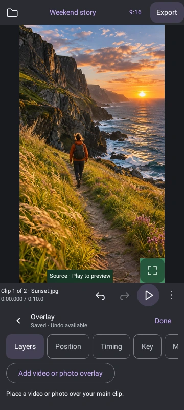</a> |
| Manage files across OnKlav and Android storage. | Trim and arrange clips in a touch-friendly editor. |

**Amazing Music Visualizing**

Listen to live radio streams from around the world and transform them into hypnotic visualizations. Choose the **Rainbow** palette to see all six effects in multicolor.

| Wave | Spectrum | Orbit |
| :---: | :---: | :---: |
| <a href="artwork/github-previews/radio-wave.webp">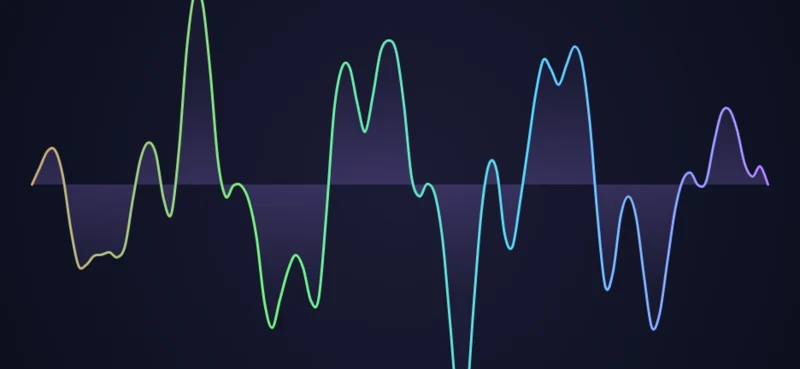</a> | <a href="artwork/github-previews/radio-spectrum.webp">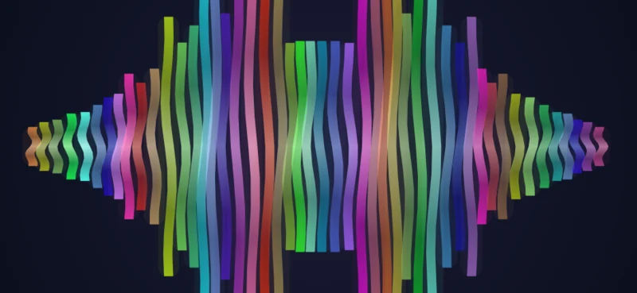</a> | <a href="artwork/github-previews/radio-orbit.webp">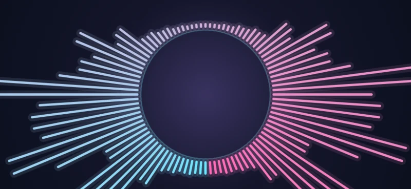</a> |

| Mandala | Slipstream | Aurora |
| :---: | :---: | :---: |
| <a href="artwork/github-previews/radio-mandala.webp">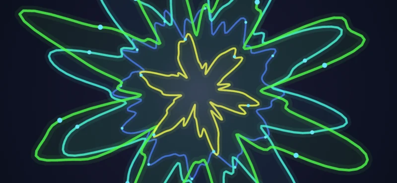</a> | <a href="artwork/github-previews/radio-slipstream.webp">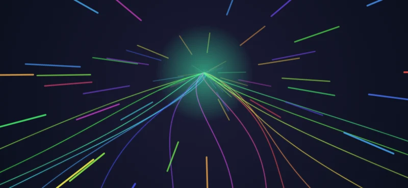</a> | <a href="artwork/github-previews/radio-aurora.webp">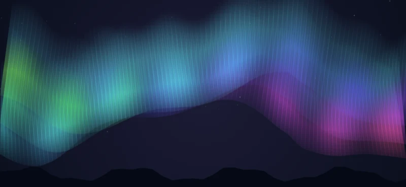</a> |

| RSS Reader | Weather | Calendar |
| :---: | :---: | :---: |
| <a href="artwork/github-previews/rss-reader.svg">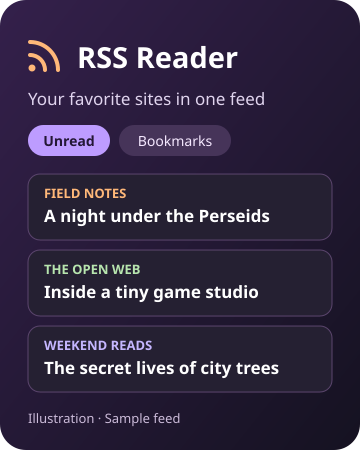</a> | <a href="artwork/github-previews/weather.svg">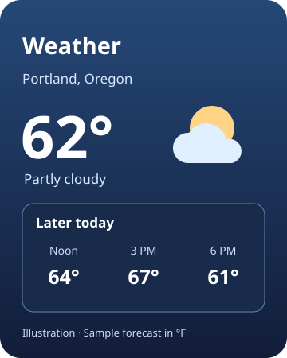</a> | <a href="docs/evidence/calendar/week.png">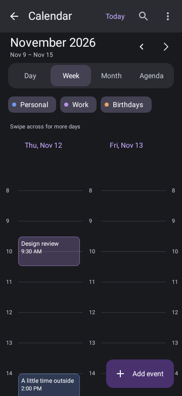</a> |
| Follow the blogs, newsrooms, and independent writers you choose. Filter for unread posts, bookmark a good read, or catch up on cached entries offline. The content available in each entry depends on what the publisher includes in its RSS or Atom feed. | Check your hometown before heading out, then look up a destination by city or U.S. ZIP code. Your saved home location stays put while you check other places. | See your day in a timeline, scan the week for gaps, or zoom out to the month. Use recurring events and reminders for the things you do every week. Your calendar works offline and needs no account. |

## Themes

Choose a built-in look under **Settings → Appearance**. The same conversation
looks different in each preset, from the wallpaper and header accent to the
message bubbles and their text.

<a href="artwork/github-previews/message-themes.webp">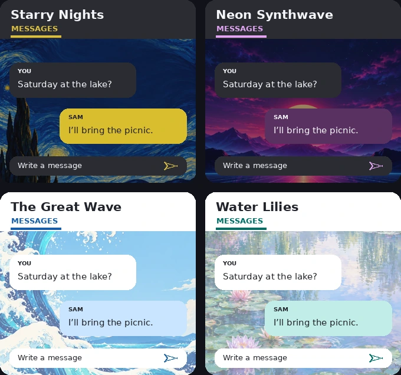</a>

*Illustrated previews using OnKlav’s built-in wallpapers and message colors.*
You can also save and share your own [theme packages](docs/THEME-PACKAGES.md).

## Included games

| Game | How to play |
| :---: | --- |
| 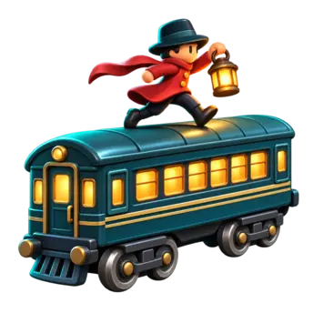<br>**Last&nbsp;Light&nbsp;Express** | **Solo.** Ten levels · fight across a moving train and face the Iron Warden. |
| <br>**Crash&nbsp;Test&nbsp;Panda** | **Solo.** Solo demolition: twelve courses, explosive chains and a shot-for-shot panda rivalry. |
| <br>**Shroom** | **Solo.** Fight through five spore-infested sectors and take down the Cap King. |
| 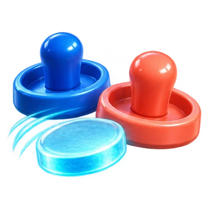<br>**Air&nbsp;Hockey** | **Solo.** Solo Air Hockey · ten goals · Illuminated arcade table. |
| <br>**Naval&nbsp;Battle** | **Solo or SMS friend match.** Outsmart your opponent and destroy their ships. |
| 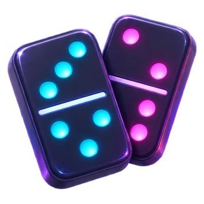<br>**Neon&nbsp;Dominos** | **Solo.** Earn pips by playing tiles, then subtract the pips you still hold. Highest total after three rounds wins. |
| <br>**Cats&nbsp;vs&nbsp;Dogs** | **Solo or SMS friend match.** Classic four in a row with a playful twist. |
| <br>**Blackjack** | **Solo or SMS friend match.** Test your luck and skill in a blackjack tournament. |

## All the Apps You Need

Find these built-in tools on the Apps desktop or bottom navigation.

### Communication

<table>
  <tr>
    <td width="160" align="center" valign="top"><br><strong>Phone</strong><br>Call contacts or dial a number.</td>
    <td width="160" align="center" valign="top"><br><strong>Messages</strong><br>Text friends and keep favorite photos and messages handy.</td>
    <td width="160" align="center" valign="top"><br><strong>Groups</strong><br>Keep group texts with family and friends together.</td>
  </tr>
  <tr>
    <td width="160" align="center" valign="top"><br><strong>Email</strong><br>Read and send mail from your existing inbox.</td>
    <td width="160" align="center" valign="top"><br><strong>Real Social</strong><br>Share updates and photos with friends over SMS and MMS.</td>
    <td width="160" align="center" valign="top"><br><strong>Walkie-Talkie</strong><br>Send a quick voice message with push-to-talk controls.</td>
  </tr>
</table>

### Web & listening

<table>
  <tr>
    <td width="160" align="center" valign="top"><br><strong>Browser</strong><br>Browse the web and open links inside OnKlav.</td>
    <td width="160" align="center" valign="top"><br><strong>YouTube</strong><br>Find and watch YouTube videos from OnKlav.</td>
    <td width="160" align="center" valign="top"><br><strong>RSS Reader</strong><br>Follow your favorite sites and save articles for later.</td>
  </tr>
  <tr>
    <td width="160" align="center" valign="top"><br><strong>Radio</strong><br>Tune in worldwide and turn live audio into moving visuals.</td>
    <td width="160" align="center" valign="top"><br><strong>Podcasts</strong><br>Find shows and download episodes for offline listening.</td>
    <td width="160" align="center" valign="top"><br><strong>AudioBooks</strong><br>Discover free audiobooks for your next commute.</td>
  </tr>
  <tr>
    <td width="160" align="center" valign="top"><br><strong>eBooks</strong><br>Find free books or read EPUBs from your own library.</td>
    <td width="160" align="center" valign="top"><br><strong>Read Aloud</strong><br>Listen to text with built-in speech voices.</td>
    <td></td>
  </tr>
</table>

### Create & capture

<table>
  <tr>
    <td width="160" align="center" valign="top"><br><strong>Camera</strong><br>Capture photos and videos from OnKlav.</td>
    <td width="160" align="center" valign="top"><br><strong>Image Edit</strong><br>Crop and retouch photos before you share them.</td>
    <td width="160" align="center" valign="top"><br><strong>Video Edit</strong><br>Trim and arrange clips into a video worth sharing.</td>
  </tr>
  <tr>
    <td width="160" align="center" valign="top"><br><strong>Audio Edit</strong><br>Trim recordings and clean up audio clips.</td>
    <td width="160" align="center" valign="top"><br><strong>Voice Record</strong><br>Capture voice notes, ideas, and reminders.</td>
    <td width="160" align="center" valign="top"><br><strong>Screen Record</strong><br>Record a walkthrough or save a moment on screen.</td>
  </tr>
  <tr>
    <td width="160" align="center" valign="top"><br><strong>Write</strong><br>Draft anything from a quick note to a formatted document.</td>
    <td width="160" align="center" valign="top"><br><strong>Code Edit</strong><br>Open and edit source files right on your phone.</td>
    <td></td>
  </tr>
</table>

### Files & privacy

<table>
  <tr>
    <td width="160" align="center" valign="top"><br><strong>Files</strong><br>Organize and move files between OnKlav and Android storage.</td>
    <td width="160" align="center" valign="top"><br><strong>Cloud Files</strong><br>Browse files in supported cloud storage accounts.</td>
    <td width="160" align="center" valign="top"><br><strong>Docu View</strong><br>Open PDFs and other supported documents for reading.</td>
  </tr>
  <tr>
    <td width="160" align="center" valign="top"><br><strong>Compress</strong><br>Shrink media files or bundle a folder into a ZIP.</td>
    <td width="160" align="center" valign="top"><br><strong>Format Swap</strong><br>Convert supported files on your phone.</td>
    <td width="160" align="center" valign="top"><br><strong>Vault</strong><br>Keep private notes in a password-protected, encrypted vault.</td>
  </tr>
  <tr>
    <td width="160" align="center" valign="top"><br><strong>Authentic</strong><br>Generate two-factor sign-in codes offline.</td>
    <td></td>
    <td></td>
  </tr>
</table>

### Everyday tools

<table>
  <tr>
    <td width="160" align="center" valign="top"><br><strong>Calendar</strong><br>Plan your week and set reminders without an account.</td>
    <td width="160" align="center" valign="top"><br><strong>Clock</strong><br>Set alarms, start timers, or use the stopwatch.</td>
    <td width="160" align="center" valign="top"><br><strong>Maps</strong><br>Find places nearby and look up routes.</td>
  </tr>
  <tr>
    <td width="160" align="center" valign="top"><br><strong>Weather</strong><br>Check the forecast at home or where you're headed.</td>
    <td width="160" align="center" valign="top"><br><strong>Calc</strong><br>Work out quick sums and everyday calculations.</td>
    <td width="160" align="center" valign="top"><br><strong>Convert</strong><br>Switch between common units of measurement.</td>
  </tr>
  <tr>
    <td width="160" align="center" valign="top"><br><strong>Flashlight</strong><br>Light up a dark room with your phone.</td>
    <td width="160" align="center" valign="top"><br><strong>Power</strong><br>Open Android's restart and power-off menu.</td>
    <td></td>
  </tr>
</table>

### System

<table>
  <tr>
    <td width="160" align="center" valign="top"><br><strong>Settings</strong><br>Customize themes, app visibility, and OnKlav preferences.</td>
  </tr>
</table>

## Make, share, and install

Build the app, utility, or game you want using the [App SDK](developer/README.md)
or [Game SDK](developer/games/README.md). Sign your package, then share the file
directly with friends or publish it wherever you like. Once OnKlav is installed,
its apps and games install **inside OnKlav without separate APKs or a Google Play
Store listing**. OnKlav runs signed packages in sandboxed environments and
mediates access to supported device capabilities.

1. **Get the package.** Use a signed file you made, downloaded, or received from someone else.
2. **Open OnKlav’s installer.** For an app (`.onklav-a`), go to **Settings → Apps → Install App**.
   For a game (`.onklav-g`), open **Games → Games manager → Install a game**.
3. **Select and install.** Review the publisher and any app permissions.
   Your new app appears in Apps, and your new game appears in Games.

## How it fits together

One APK contains the Kotlin/Compose host, shared Rust services, signed
internal apps, and the shared Godot Web game engine. The repository contains
the source for OnKlav 0.101.54-rc1 and both SDKs.

Start with [START-HERE.md](START-HERE.md), [current tasks](TODO.md), or the
[SDK guide](sdk/README.md).

## Speech

OnKlav includes two English text-to-speech choices for Messages, readers, and
SDK apps. Choose **Male (Bruno)**, the default, or **Female (Maya)**. Maya is an
OnKlav nickname for the existing Female option. The two bundled Kitten Nano
voices are classified as male upstream. See [shared speech](docs/NEURAL-SPEECH.md).

## Build

JDK17, SDK36/build-tools35, Gradle8.11.1 and the original Android signer are required. Reuse source-current native/SDK/game outputs. Changes to native speech need Rust1.90 and NDK27.2.12479018.

```sh
python3 scripts/build.py --plan
python3 scripts/build.py  # optimized release; debug is for development
python3 scripts/check_android.py --tests-only --test app.onklav.home.NeuralSpeechTest
```

Phone/carrier/Bluetooth/endurance and public distribution qualification remain separate from host tests and APK verification. Active backup/document adoption and Notes recovery protect existing user data. Historical milestones are retained in docs/history/pre-0.100.24. Keep third-party licenses/corresponding source and signing identities.

See [size and responsiveness](docs/SIZE-AND-RESPONSIVENESS.md) for measured package changes, preserved features and device-validation limits.

## Help improve OnKlav

Try the prerelease and [report a bug](https://github.com/JustTrySomthing/OnKlav/issues/new/choose),
improve a guide or share a theme, or contribute code. The
[contributor guide](CONTRIBUTING.md) explains setup, tests, and pull requests.
Browse [good first issues](https://github.com/JustTrySomthing/OnKlav/labels/good%20first%20issue)
if you’d like a small place to start. [SDK checks](https://github.com/JustTrySomthing/OnKlav/actions/workflows/sdk-checks.yml) run on pull requests.

## License

Copyright (C) 2026 OnKlav. OnKlav-owned host, App SDK, and Game SDK
code is licensed under GPL-3.0-or-later. See [LICENSE](LICENSE),
[App SDK licensing](developer/LICENSE.md), and
[Game SDK licensing](developer/games/LICENSE.md). Third-party
materials retain their own notices and terms. See the
[distribution review](docs/PUBLIC-RELEASE-LICENSING.md) for bundled
content and outstanding rights checks.
